```{r}
#| include: FALSE
#| eval: true

set.seed(0)

library(tidyverse)

library(gt) # for tables
```


```{r eval=FALSE, echo=FALSE}
# re-run to update references
# re-run to update citations
# remotes::install_github("paleolimbot/rbbt")
keys <- rbbt::bbt_detect_citations(path = "ch2_main.qmd")
ignore <- c("^fig-", "^tbl-", "^sec-")
for (pt in ignore) {
  keys <- grep(pt, keys, invert = TRUE, value = TRUE)
}
rbbt::bbt_write_bib(keys = keys, path = "references.bib", overwrite = TRUE, library_id = rbbt::bbt_library_id("CSAFE"), translator = "bibtex")
```


# Background \& Summary {#sec-background-summary .unnumbered}


In forensic analysis, marks left at crime scenes play an important role, and forensic examiners are particularly interested in identifying their origin, a process known as the Source Identification Problem in Forensic Science [@lindleyProblemForensicScience1977].
The forensic science community focuses on two distinct problems: the **specific source problem**, in which examiners aim to determine whether a mark was left by a particular tool, and the **common source problem**, in which examiners aim to determine whether two marks were left by the same tool.
Currently, accepted practice for both problems relies on visual inspection of physical items under a comparison microscope.
Examiners then report their conclusions according to the Theory of Identification [@afteAssociationFirearmTool1998], developed by the Association of Firearm and Toolmark Examiners (AFTE), using one of three categories: *identification*, in which the marks are believed to have been made by the same source; *elimination*, in which the marks are believed to have been made by different tools; and *inconclusive*, in which the similarities or dissimilarities between marks are insufficient to support either identification or elimination.
This process has been criticized by the National Research Council (NRC) [@nationalresearchcouncilu.s.StrengtheningForensicScience2009a] and the President's Council of Advisors on Science and Technology (PCAST) [@presidentscouncilofadvisorsonscienceandtechnologyForensicScienceCriminal2016] for its lack of objectivity and absence of quantifiable measurements, such as error rates.

In discussing error rates, Biedermann [@biedermannStrangePersistenceSource2022] differentiates between internal and external perspectives.
The external perspective allows general statements based on black-box studies that relate examiners' conclusions to ground truth; however, it does not consider the evidence in a particular case.
Introducing an internal perspective requires evaluating similarity between pairs of specimens with known ground truth.
Algorithms allow these similarities to be quantified objectively and reproducibly.

Advances in microscopy have made it possible to move from optical two-dimensional imaging to digital three-dimensional topographic scanning, allowing algorithmic assessment of the similarity between pairs of forensic pattern evidence [@bonfantiVisualisationConfocalMicroscopy2000].
This transition has already supported practical advances in bullet and cartridge comparisons, including visual inspection of bullet line scans from three-dimensional topographic images [@smithLinescanImagingBallistics2002], the use of features extracted by fast Fourier transform (FFT) as the basis of an artificial intelligence system [@liBallisticsProjectileImage2006], an automated pilot study based on consecutively matching striae [@chuPilotStudyAutomated2010] (a feature also used by some laboratories in casework), and the incorporation of three-dimensional imaging into routine casework at the Alabama Department of Forensic Sciences (ADFS) [@mcclarinAddingObjectiveComponent2015].

When cut wires are found at a crime scene, understanding the characteristics of marks left by bladed tools becomes essential.
When a blade cuts a wire, it leaves striations on the surface, as shown in @fig-cut-microscope.
These striations provide a basis for similarity assessment and source identification.
Similar scans have supported the development of quantitative methods for analyzing firearms and other toolmark evidence.
For example, studies of screwdriver striations have examined key factors affecting comparisons, including angles of attack [@baikerToolmarkVariabilityQuality2015a], rotational axes [@garciaInfluenceAxialRotation2017], and cutting directions [@cuellarAlgorithmForensicToolmark2024].
Foundational research on forensic toolmarks has also emphasized data collection and analysis, including the collection and distribution of datasets for bullet and toolmark analysis [@maNISTBulletSignature2004; @zhengNISTBallisticsToolmark2016], numerical methods for improving accuracy and consistency [@chuAutomaticIdentificationBullet2013; @vorburgerApplicationsCrosscorrelationFunctions2011], and techniques for quantifying similarity [@hareAutomaticMatchingBullet2017; @juOpenSourceImplementationCMPS2022].


```{r}
#| echo: false
#| out.width: "400px"
#| label: fig-cut-microscope
#| fig-pos: hbt
#| fig-cap: >-
#|   Microscopic wire-cut striations.
#|   Close-up of striations left by a blade on the cut end of a wire; the schematic identifies the ridge separating the two roof-like surfaces scanned separately as scans A and B.
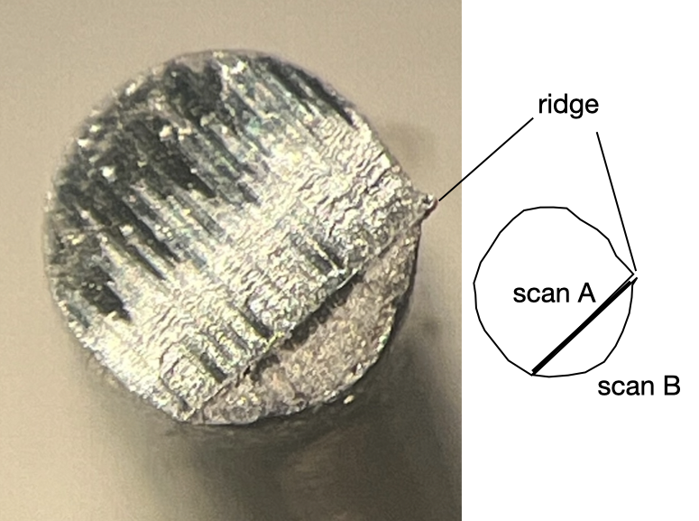
```

Data collected at crime scenes lack the known ground truth needed to estimate error rates; therefore, controlled studies are needed.
In this study, we provide a publicly available dataset of wire-cut scans together with a systematic quantitative processing and comparison workflow.
The shared materials include raw scans, metadata, manually extracted profiles, processed signals, pairwise cross-correlation function (CCF) values, derived images, and analysis code.

Methods describes sample collection, scanning, profile extraction, signal processing, and CCF-based alignment.
Data Records describes the shared files and repository organization.
Technical Validation examines the relationship between similarity scores and source, presents descriptive summaries of pairwise CCF values, and assesses variability across replicates, stagings, and acquisitions.
Usage Notes provides practical guidance for working with the shared files, and Code Availability identifies the custom processing and validation code.
The dataset and workflow may support future quantitative research on wire-cut evidence.


# Methods {#sec-methods .unnumbered}

Five Kaiweets KWS-105 multipurpose tools with 0.5-inch carbon-steel cutting blades were used to cut 16-gauge anodized pure-aluminum wire.

While aluminum is not commonly used for electric wiring because of its poor conductivity, it was selected for its nontoxicity and suitability for receiving cutting marks and retaining them during subsequent handling.
Pure aluminum has a Brinell hardness of approximately 15 HB, which places it between lead (approximately 5 HB) and copper (approximately 35 HB).


## Scan acquisition {#sec-cutting-wires .unnumbered}

The blades of each of the five wire cutters were labeled A, B, C, and D (see @fig-cut-tent-scan (a)).
B opposes A; the reverse sides are labeled D for A and C for B.
Three locations on each blade were marked (inner, middle, and outer), as shown in @fig-cut-tent-scan (a).
Each four-inch wire segment was cut in half, creating two cut sides, AB and CD.
The cut surface of the wire is not flat; under the microscope, it reveals a roof-like structure with a ridge separating the markings made by each blade (see @fig-cut-microscope).
The two roof sides of each cut surface were scanned separately, yielding scans A and B from cut side AB and scans C and D from cut side CD.
As an example, the four scans from the second replicate cut by tool 1 at the inner location are shown in @fig-cut-tent-scan (c).

:::: {#fig-cut-tent-scan layout="[29, -2, 69]" fig-pos="hbt"}

:::{}

\vspace{0pt}

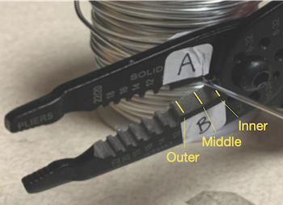{#fig-plier-tip height=16%}

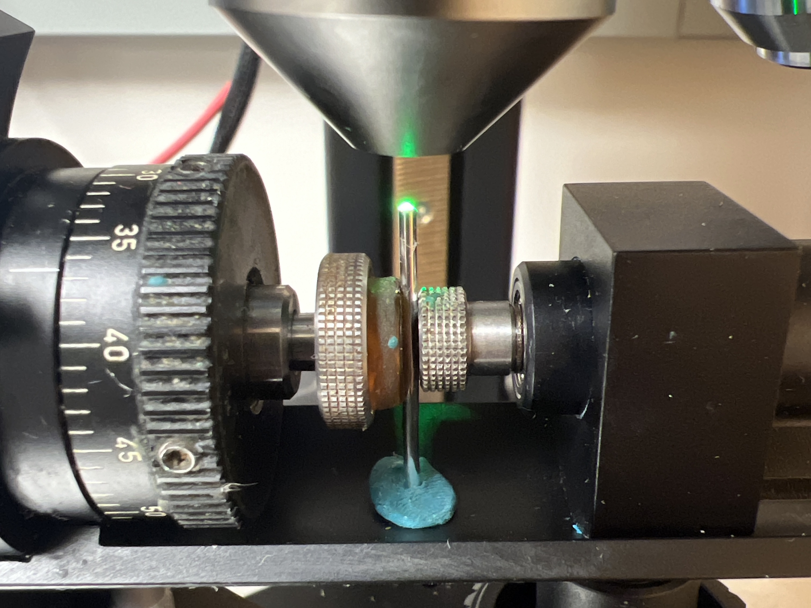{#fig-wire-microscope height=16%}

:::

:::{}

\vspace{0pt}

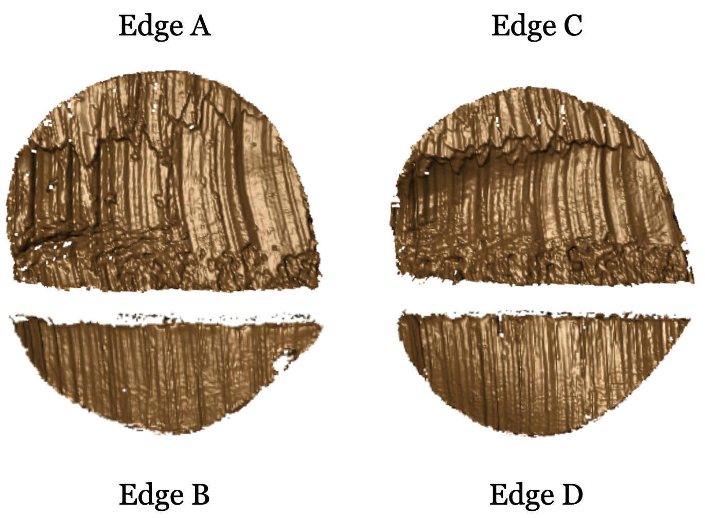{#fig-T1AW-LI-R2-4edges height=40%}
:::

Wire-cut sampling and scanning workflow.
\(a) A Kaiweets KWS-105 wire cutter with inner, middle, and outer locations marked.
(b) A confocal microscope used to scan wire-cut surfaces.
(c) Four scans of cutting marks labeled according to the corresponding cutting edges A, B, C, and D.

::::

The cut surfaces were scanned at 20$\times$ magnification using a Sensofar S neox confocal microscope, shown in @fig-cut-tent-scan (b).
The scans were exported in \texttt{x3p} format (ISO 25178-72:2017/Amd 1:2020) with a lateral resolution of 0.645 $\times$ 0.645 micrometers per pixel and a vertical resolution of 0.1 micrometer.

The main experiment therefore consists of 5 tools $\times$ 3 locations $\times$ 2 replicates $\times$ 4 cut surfaces = 120 scans from 30 cuts.
Tool 2 and the middle cutting location were randomly selected for variability assessment.
Fourteen additional scans of the second replicate at this tool and location were collected across repeated stagings and acquisitions, giving 134 scans in total.
These repeated scans do not represent additional cuts; their acquisition design is described later in Technical Validation.

Each scan identifier specifies the tool, edge, cutting location, replicate, and, where applicable, staging and acquisition according to the following convention:

\begin{samepage}
\begin{verbatim}
T__W-L_-R_[-S_[-A_]]
 ||   |  |   |   |
 ||   |  |   |   +-- Acquisition: 2, 3, or 4
 ||   |  |   +------ Staging: 2 or 3
 ||   |  +---------- Replicate: 1 or 2
 ||   +------------- Location: I (inner), M (middle), or O (outer)
 |+----------------- Edge: A, B, C, or D
 +------------------ Tool: 1, 2, 3, 4, or 5
\end{verbatim}
\end{samepage}

Square brackets denote optional suffixes and are not part of the identifiers.
Staging and acquisition suffixes are omitted when their corresponding value is 1; these values are recorded explicitly in the metadata and signal files.
In our scans, acquisition suffixes occur only at staging 3.
For example, T1AW-LI-R1 denotes the first replicate of a piece cut with edge A of tool 1 at the inner location, at staging 1 and acquisition 1.
T2AW-LM-R2-S3-A2 denotes the second acquisition at the third staging of replicate 2, cut with edge A of tool 2 at the middle location.

To minimize errors during data collection, two team members cut and labeled the wire pieces together.
One team member scanned the wire cuts and assigned names to the scans as described.


## Signal extraction {#sec-extract-profiles .unnumbered}

Signals were extracted from each surface scan using a two-step procedure.
First, a representative profile was identified along a line across the surface perpendicular to the dominant striation direction.
This line was chosen manually to avoid scanning artifacts (e.g., holes) and cutting artifacts (e.g., rips caused by rolling the wire).
Along this line, surface values were assigned at equally spaced positions by taking the median of nearby observed surface values grouped at each position.

@fig-T1AW-LI-R1-profiles-signals shows a scan on the left (a) with the location of the manually chosen profile line in yellow.
The corresponding profile and signal are plotted in (b) and (c).


:::: {#fig-T1AW-LI-R1-profiles-signals layout="[45, 55]" fig-pos="hbt"}

:::{}

\vspace{0pt}

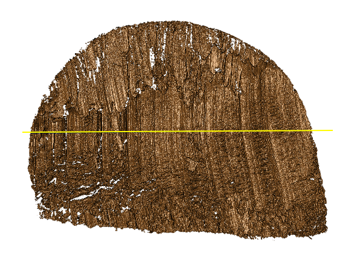{#fig-T1AW-LI-R1-profiles height=37%}

:::

:::{}

\vspace{0pt}

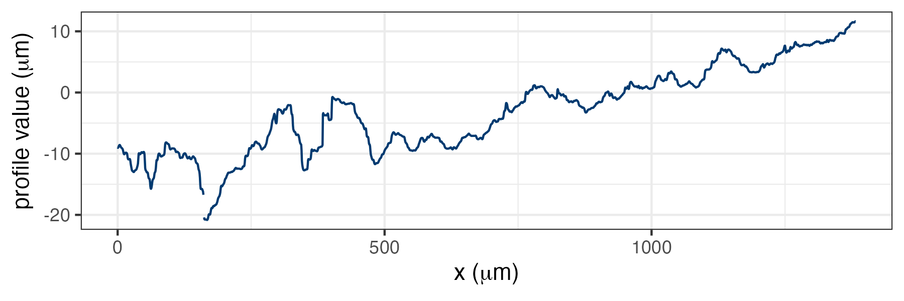{#fig-T1AW-LI-R1-profiles-plot height=16%}

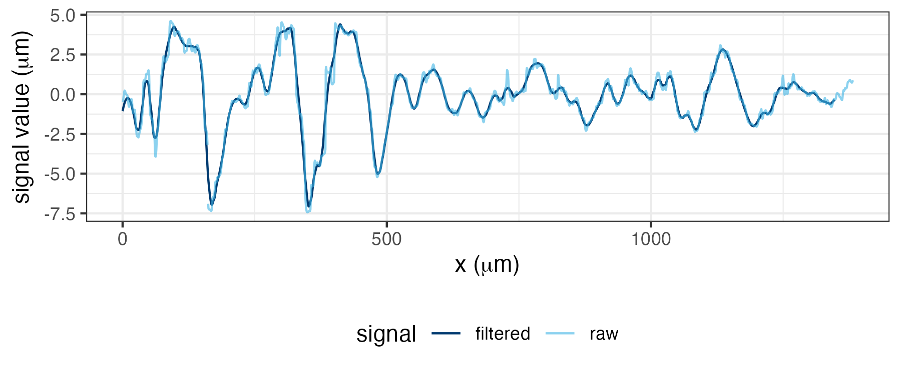{#fig-T1AW-LI-R1-signals-plot height=16%}
:::

Profile and signal extraction.
\(a) A yellow profile line drawn across the scan striations.
(b) The profile function extracted along the line in (a).
(c) Raw and filtered signals obtained from the profile function in (b).

::::

In a second step, the scan's signal was extracted by removing trends and outliers from the surface values of the profile using two locally weighted scatterplot smoothing (LOWESS) filters with bandwidths of $400\,\mu\mathrm{m}$ and $40\,\mu\mathrm{m}$, respectively [@clevelandLocalRegressionModels1992].
All smoothers are susceptible to boundary issues, particularly when outliers are present.
Steep changes at the end of a signal have a high potential to attract another signal during alignment, causing misalignments.
To avoid potential artificial ``hooks'' at either end of a signal, two-sample $t$-tests were applied to the surface values in the outermost 2.5\% intervals along the horizontal axis.
Specifically, the summary statistics (sample size, mean, and standard deviation) of the signal values within the intervals $[0, 2.5)\%$, $[2.5, 5)\%$, $(95, 97.5]\%$, and $(97.5, 100]\%$ were calculated.
At each end, the test compared the outermost 2.5\% interval with the adjacent interval.
The signal values in the outermost interval were retained only when the corresponding $p$-value was above 0.01, indicating no statistically significant shift at that level.

The widths of these intervals correspond to the choice of bandwidths and the length of the signal.
The interval widths were determined using cross-validation.
The resulting signals are used for subsequent comparisons with other signals.
One profile for each scan is included in the `profiles/` folder as a CSV file in the repository using the same naming convention as the scans, with the prefix `profiles-`.
More details on the exact format of these files are provided below.
A single file containing signals for all 134 scans is available in `data-derived/wire-signals.csv.zip`.


## Pairwise alignment of signals {#sec-align-signals .unnumbered}

Before comparison, signals from different scans were aligned.
For each pair of signals, the value of the cross-correlation function (CCF) was calculated across relative shifts, requiring an overlap of at least 1,000 nonmissing profile samples.
The shift corresponding to the maximum CCF was retained as the alignment position.
The maximized cross-correlation function, $\mathrm{CCF}_{\max}$, gives a measure of the similarity of the signals, with a value of 1 indicating complete similarity (apart from linear scaling) and a value of 0 indicating no linear correlation at the selected alignment.

@fig-signals-pair-alignment shows all signals corresponding to cuts 1 and 2 made with tool 1 at the location closest to the pivot area (inner location).
Each of the four edges corresponds to one row in the figure.
The lines in the first two columns correspond to the extracted signals for cuts 1 and 2, respectively.
The third column shows the two signals aligned at the location of the maximal CCF.
The cross-correlation value for each pair is included as part of the title of the chart.

```{r}
#| echo: false
#| out.width: "500px"
#| fig-pos: hbt
#| label: fig-signals-pair-alignment
#| fig-cap: >-
#|   Same-source signal alignment.
#|   Rows correspond to cut surfaces A, C, B, and D.
#|   The first two columns show signals extracted from scans corresponding to the replicate cuts of tool 1 at location I; the third column overlays the aligned signals and reports their CCF values.
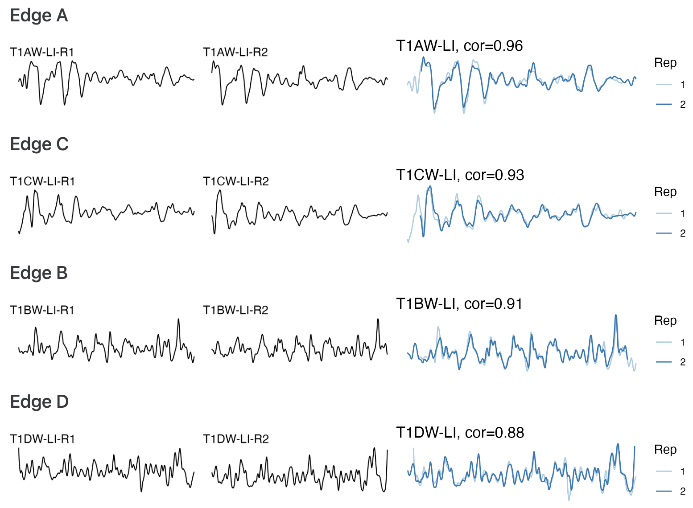
```

The file `data-derived/wire_pairwise_ccf.csv` contains the CCF similarity scores of all pairwise aligned signals.


## AI-assisted manuscript preparation {.unnumbered}

Before using Codex (OpenAI), the authors completed the experimental work and data collection, obtained the main results, and wrote the analysis code and complete manuscript.
Codex subsequently assisted with language editing, organization, formatting, checks against journal requirements, and review for inconsistencies in the manuscript, code, and numerical reporting.
The authors reviewed and verified the revisions and retain full responsibility for the scientific decisions and the accuracy and integrity of the manuscript.


# Data Records {#sec-data-records .unnumbered}


The repository record on Iowa State University DataShare [@DatasetCodeThreedimensionalDataWirecut] at \url{https://doi.org/10.25380/iastate.34025028} contains the \texttt{x3p} scans, metadata, extracted profiles, processed signals, pairwise CCF values, derived images, analysis code, and supporting documentation and environment files.
The data files, formats, and folder organization are summarized in @tbl-data-overview.
All 134 scans share the root-level \texttt{scans/}, \texttt{profiles/}, \texttt{pngs/}, and \texttt{profile-images/} folders, a single \texttt{meta.csv}, and the derived files in \texttt{data-derived/}.
The same file structures describe both the main experiment and the repeated scans used for variability assessment.
The 120 main-experiment scans have \texttt{staging = 1} and \texttt{acquisition = 1}; the 14 additional scans have staging 2 or 3.
Scan identifiers link the metadata, profiles, signals, and images, and both identifier columns in the pairwise file refer to this shared set.


```{r}
#| echo: FALSE
#| label: tbl-data-overview
#| tbl-cap: Structure of available data and files.
#| tbl-pos: hbt
#| results: asis

gt_table <- tibble(
  group_type = c(rep("Raw data", 2), "Manual derivatives", rep("Computational derivatives in the folder 'data-derived/'", 2), rep("Image files", 2)),
  data_type = c("`scans/`", "`meta.csv`", "`profiles/`", "`wire-signals.csv.zip`", "`wire_pairwise_ccf.csv`", "`pngs/`", "`profile-images/`"),
  Description = c("134 topographic 3D scans from 30 aluminum wire cuts, including 14 repeat scans (`x3p` format)", "scan identifiers, paths, tool, edge, location, replicate, staging, acquisition, and pixel dimensions (CSV format)", "134 manually extracted profiles, one per scan (CSV format)", "profile values and derived signals for all 134 scans (compressed CSV format)", "17,956 ordered pairwise CCF values for all 134 signals (CSV format)", "134 images of 3D wire-cut scans (PNG format)", "134 scan images showing the manually selected profile lines (PNG format)"),
  Section = c("Scan acquisition", "Scan acquisition", "Signal extraction", "Signal extraction", "Pairwise alignment of signals", "Scan acquisition", "Signal extraction")
) %>%
  group_by(group_type) %>%
  gt(rowname_col = "data_type") %>%
  tab_stubhead(label = "Data type") %>%
  tab_options(table.width = pct(97), table.font.size = px(14.67)) %>%
  cols_width(data_type ~ pct(25), Description ~ pct(60), Section ~ pct(15), everything() ~ pct(20)) %>%
  fmt_markdown()
# gt_table contains the markdown version of the table the way it is supposed to look.
# the errors get introduced in the as_latex function

string <- gt_table %>% as_latex()

# # column widths code - start
# # has bug: column Description is not being recognized, last section is the widest
# # bug fix: it seems, that this is a shift in the column numbers:
# # - description width is controlled by data_type.
# # - Section width is controlled by Description.
dimexprs <- str_extract_all(pattern = "dimexpr 0.[0-9]+", string[1])[[1]]
# the dimension expressions have now changed to
# "dimexpr 0.19" "dimexpr 0.24" "dimexpr 0.58"
# replace these with
replacement <- paste("dimexpr", c(0.32, 0.50, 0.18))
string[1] <- str_replace_all(pattern = "dimexpr 0.[0-9]+", replacement = "dimexpr FIX", string[1])
# replace one by one
for (i in seq_along(dimexprs)) {
  string[1] <- str_replace(string[1], "dimexpr FIX", replacement[i])
}
# column width - end

string
```

The dataset is licensed under the Creative Commons Attribution 4.0 International (CC BY 4.0) license.

The \texttt{meta.csv} file contains one record for each of the 134 scans, with ten variables described in @tbl-meta-structure.

::: {#tbl-meta-structure tbl-cap="Structure of `meta.csv`." tbl-pos="hbt"}

\begin{tabularx}{\linewidth}{llX}
\toprule
Variable & Type & Description \\
\midrule
\texttt{ID} & text & Unique scan identifier defined by the naming convention in Scan acquisition \\
\texttt{x3p\_path} & text & Path to the \texttt{x3p} scan relative to the data repository root \\
\texttt{tool} & integer & Cutting tool, one of 1 through 5 \\
\texttt{edge} & character & Cutting edge, one of A, B, C, or D \\
\texttt{location} & character & Cutting location: I (inner), M (middle), or O (outer) \\
\texttt{replicate} & integer & Replicate cut, either 1 or 2 \\
\texttt{staging} & integer & Staging of the same cut surface under the microscope: 1, 2, or 3; 1 is omitted from the scan identifier \\
\texttt{acquisition} & integer & Acquisition within a staging: 1 through 4; 1 is omitted from the scan identifier \\
\texttt{height} & integer & Height of the scan in pixels \\
\texttt{width} & integer & Width of the scan in pixels \\
\bottomrule
\end{tabularx}

:::

The \texttt{profiles/} folder contains 134 CSV files, one manually extracted profile per scan, with one sampled point per row and 266,394 rows in total.
Their four variables are described in @tbl-profile-structure in CSV column order.

::: {#tbl-profile-structure tbl-cap="Structure of the `profiles-*.csv` files." tbl-pos="hbt"}

\begin{tabularx}{\linewidth}{llX}
\toprule
Variable & Type & Description \\
\midrule
\texttt{ID} & text & Source scan identifier, matching \texttt{ID} in \texttt{meta.csv}; constant within each file \\
\texttt{x} & numeric & Horizontal coordinate along the profile in micrometers, starting at zero in increments of 0.645 \\
\texttt{y} & numeric & \texttt{y} coordinate, constant and set to zero \\
\texttt{value} & numeric & Observed surface height in micrometers; \texttt{NA} denotes a missing value \\
\bottomrule
\end{tabularx}

:::

The \texttt{data-derived/wire-signals.csv.zip} archive contains \texttt{data-derived/wire-signals.csv}, with 266,394 rows containing profile values and signals for all 134 scans.
@tbl-signal-structure describes its 13 variables in CSV column order.
Missing numeric values are encoded as \texttt{NA}; in \texttt{sig}, this also marks excluded boundary values.

::: {#tbl-signal-structure tbl-cap="Structure of the signal CSV in `wire-signals.csv.zip`." tbl-pos="hbt"}

\begin{tabularx}{\linewidth}{llX}
\toprule
Variable & Type & Description \\
\midrule
\texttt{ID} & text & Source scan identifier, matching \texttt{ID} in \texttt{meta.csv} and the profile files \\
\texttt{tool} & integer & Cutting tool, one of 1 through 5 \\
\texttt{edge} & character & Cutting edge, one of A, B, C, or D \\
\texttt{location} & text & Cutting location: I (inner), M (middle), or O (outer) \\
\texttt{replicate} & integer & Replicate cut, either 1 or 2 \\
\texttt{staging} & integer & Staging of the cut surface: 1, 2, or 3, matching \texttt{meta.csv} \\
\texttt{acquisition} & integer & Acquisition within a staging: 1 through 4, matching \texttt{meta.csv} \\
\texttt{x} & numeric & Horizontal coordinate along the profile in micrometers, starting at zero in increments of 0.645 \\
\texttt{y} & numeric & \texttt{y} coordinate, constant and set to zero \\
\texttt{value} & numeric & Observed surface height in micrometers \\
\texttt{detrend} & numeric & Surface height after subtracting the fitted linear trend in \texttt{value} versus \texttt{x}, in micrometers \\
\texttt{raw\_sig} & numeric & Residual in micrometers after removing the 400-micrometer LOWESS trend from \texttt{detrend}, before final smoothing and boundary exclusion \\
\texttt{sig} & numeric & Signal after 40-micrometer smoothing of \texttt{raw\_sig} and boundary exclusion, in micrometers \\
\bottomrule
\end{tabularx}

:::

\texttt{data-derived/wire\_pairwise\_ccf.csv} contains all 17,956 ordered pairs of 134 signals, including self-comparisons and both orders of distinct pairs.
The 120-signal main-experiment subset at staging 1 and acquisition 1 has 14,400 ordered pairs.
Its 12 variables are defined in @tbl-pairwise-structure.

::: {#tbl-pairwise-structure tbl-cap="Structure of the `wire_pairwise_ccf.csv` file.
Variables are listed in CSV column order." tbl-pos="hbt"}

\begin{tabularx}{\linewidth}{llX}
\toprule
Variable & Type & Description \\
\midrule
\texttt{ID1} & text & Scan identifier for the first signal, matching \texttt{ID} in \texttt{meta.csv} \\
\texttt{ID2} & text & Scan identifier for the second signal, matching \texttt{ID} in \texttt{meta.csv} \\
\texttt{ccf} & numeric & Maximized cross-correlation function value for the aligned signals \\
\texttt{lag} & integer & Relative shift at which \texttt{ccf} is maximized, in profile-sample increments \\
\texttt{same\_tool} & logical & Whether both signals were produced by the same tool \\
\texttt{same\_edge} & logical & Whether both signals were produced by the same tool and edge \\
\texttt{same\_location} & logical & Whether both signals were produced by the same tool, edge, and location \\
\texttt{same\_replicate} & logical & Whether \texttt{same\_location} is true and the replicate cut is the same \\
\texttt{same\_staging} & logical & Whether \texttt{same\_replicate} is true and the staging is the same \\
\texttt{same\_acquisition} & logical & Whether \texttt{same\_staging} is true and the acquisition is the same \\
\texttt{same\_source} & logical & Whether \texttt{same\_location} is true; replicate, staging, and acquisition may differ \\
\texttt{edge\_type} & text & Edge-length pairing: Long, Short, or Mixed \\
\bottomrule
\end{tabularx}

:::


# Technical Validation {#sec-technical-validation .unnumbered}


Technical validation was conducted in two areas: (1) the relationship between similarity scores and source, including validation of signal processing and alignment, and (2) variability in scores along the processing pipeline.


## Similarity score and source {#sec-similarity-score-and-source .unnumbered}


Scan processing and signal alignment were validated using the 120 main-experiment scans at staging 1 and acquisition 1 as follows.
High CCF values were expected between signals from the same source and low values between signals from different sources.
@fig-signals-pair-alignment, shown earlier in Pairwise alignment of signals, meets the expected pattern for same-source signals.
To illustrate same-source and different-source comparisons, T1AW-LI-R1 was selected as the reference scan, with T1AW-LI-R2 as the same-source scan and T2AW-LI-R1 as the different-source scan.
@fig-same-different-source-alignment (a), (b), and (c) show the reference, same-source, and different-source scans, respectively.
The same-source signal alignment, shown in @fig-same-different-source-alignment (d), has a CCF value of 0.957, consistent with the expected high similarity.
The different-source signal alignment, shown in @fig-same-different-source-alignment (e), has a CCF value of 0.632, lower than that of the same-source comparison and consistent with the expected lower similarity.
For the following summaries, edges A and C were categorized as long, edges B and D as short, and comparisons pairing one long edge with one short edge as mixed.
The resulting CCFs for all pairwise comparisons were also summarized using boxplots and receiver operating characteristic (ROC) curves.
These summaries count each distinct unordered pair once and exclude self-comparisons.
@fig-ccf-comparison (a) groups CCF distributions from left to right by same source, different location, different edge, and different tool, in order of decreasing expected similarity, with the paired edges identified on the horizontal axis.
Comparisons between different edges remain difficult to interpret, even when CCF values are high, because edges A and C, or B and D, of some tools may produce similar striations that are difficult to distinguish.
@fig-ccf-comparison (b) shows classification performance separately for long and short edge classes, comparing same-source pairs with different-tool pairs.
The ROC curves plot sensitivity, or the true positive rate, against the false positive rate (FPR; 1 - specificity).
The curves are close to the upper-left corner, indicating strong classification performance.
Each edge class contains 30 same-source pairs and 1,440 different-tool pairs.
Pairs with CCF values at or above a threshold were classified as same-source.
Thresholds were selected separately for each edge class on a 0.001 grid as the smallest values giving empirical FPRs below 0.05 and 0.01.
For long-edge pairs, thresholds of 0.657 and 0.718 yield FPRs of 0.0493 and 0.0090, with false negative rates (FNRs) of 0 and 0.0333, respectively.
For short-edge pairs, thresholds of 0.518 and 0.595 yield FPRs of 0.0472 and 0.0097, respectively, with FNR 0 at both thresholds.
These rates describe the supplied comparisons, which share scans; performance was not assessed on an independent test set.
These results are consistent with the expected pattern and support the technical validation of the pipeline for processing and aligning signals.


::: {#fig-same-different-source-alignment layout="[[32, -2, 32, -2, 32], [100], [100]]" layout-valign="top" fig-pos="hbt"}

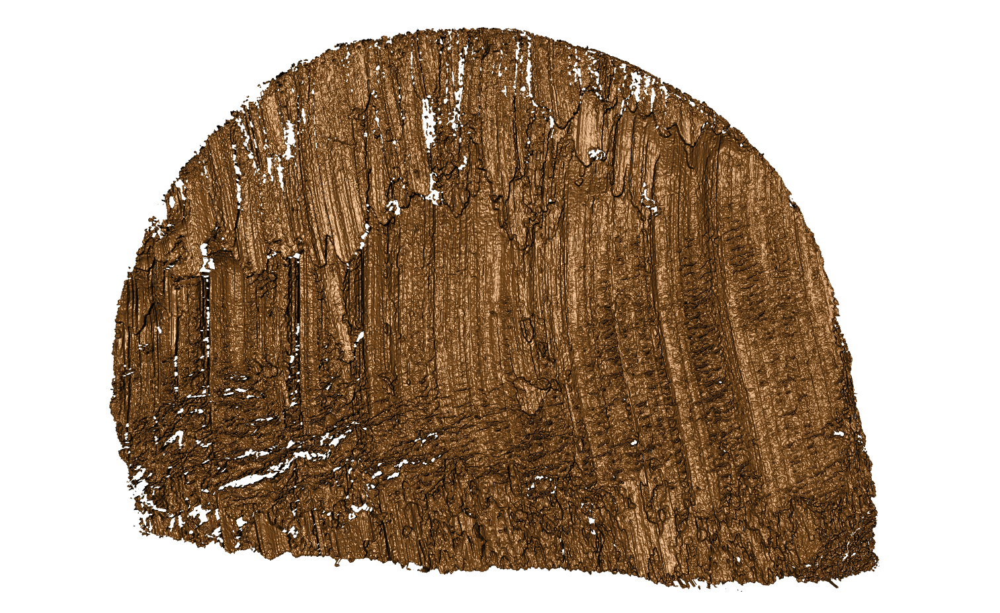{#fig-T1AW-LI-R1 width=100%}

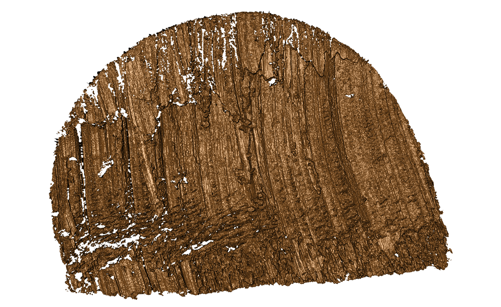{#fig-T1AW-LI-R2 width=100%}

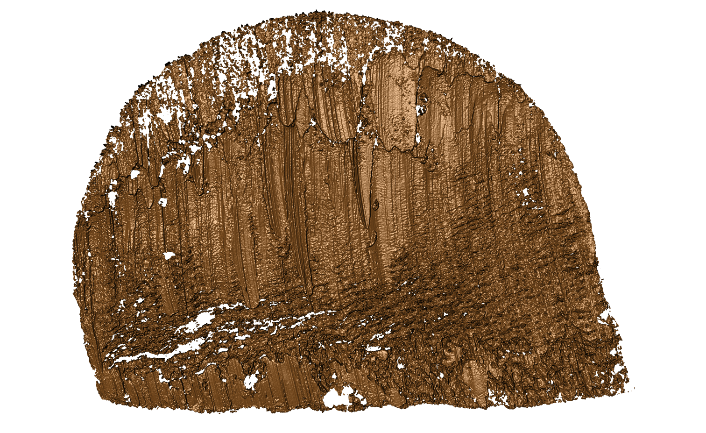{#fig-T2AW-LI-R1 width=100%}

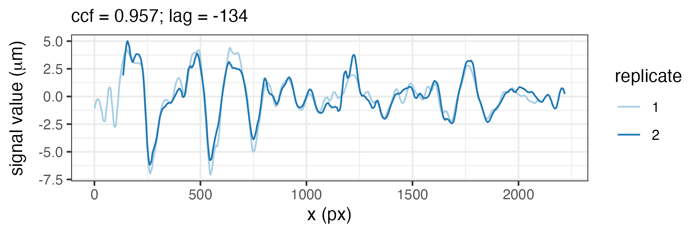{#fig-T1AW-LI-R1-T1AW-LI-R2 width=100%}

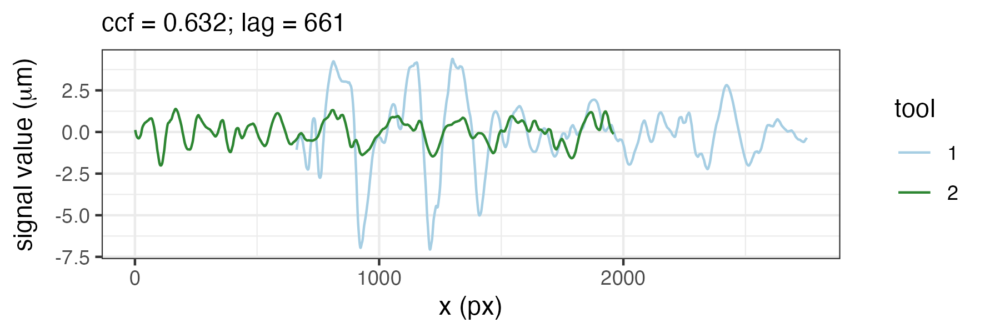{#fig-T1AW-LI-R1-T2AW-LI-R1 width=100%}

Same-source and different-source scan and signal comparisons.
\(a) Reference scan T1AW-LI-R1 cut by tool 1.
(b) Same-source scan T1AW-LI-R2 from a second cut by tool 1 at the same edge and location.
(c) Different-source scan T2AW-LI-R1 cut by tool 2.
(d) Alignment of signals from T1AW-LI-R1 and T1AW-LI-R2.
Light and dark blue lines identify the reference signal (replicate 1) and the same-source signal (replicate 2), respectively.
(e) Alignment of signals from T1AW-LI-R1 and T2AW-LI-R1.
Light blue and green lines identify the reference signal (tool 1) and the different-source signal (tool 2), respectively.
Both alignment panels report the maximized CCF and the corresponding lag.

:::


::: {#fig-ccf-comparison layout="[66.93, -2, 31.07]" layout-valign="top" fig-pos="hbt"}

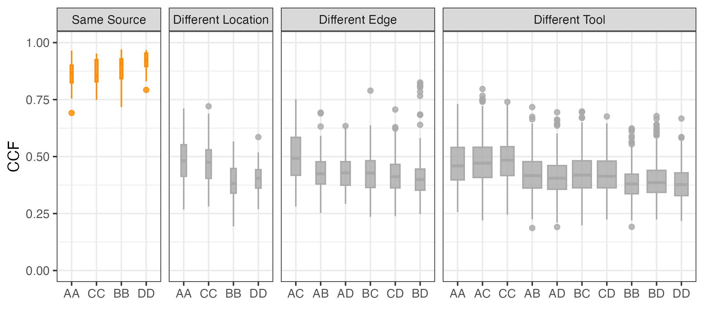{#fig-ccf-boxplot width=100%}

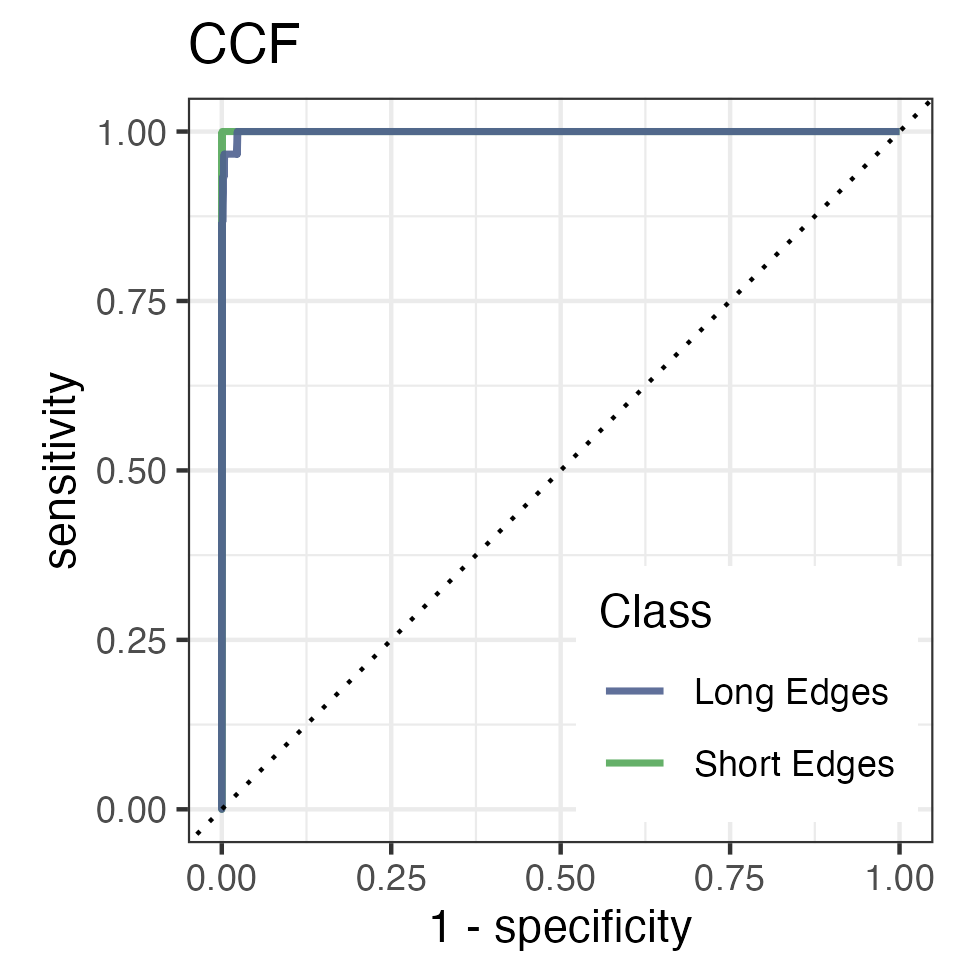{#fig-ccf-ROC width=100%}

CCF distributions and source-classification performance.
Comparisons use the 120 main-experiment scans at staging 1 and acquisition 1; each distinct unordered pair is counted once, excluding self-comparisons.
\(a) CCF distributions across comparison classes, with facets ordered from left to right by decreasing expected similarity: same source, different location, different edge, and different tool.
Orange boxplots show same-source comparisons; gray boxplots show different-source comparisons.
Boxes span the interquartile range, center lines mark medians, and whiskers extend to the most extreme values within 1.5 interquartile ranges of the boxes.
Points beyond the whiskers are outliers, and box widths reflect comparison counts through square-root scaling.
Horizontal-axis labels identify the paired edges.
(b) ROC curves comparing same-source pairs with different-tool pairs separately for long and short edge classes; same-tool different-source pairs are excluded.
The dotted diagonal indicates chance-level classification.

:::


## Variability assessment of score along the processing pipeline {#sec-variability-of-score-along-the-processing-pipeline .unnumbered}


As an overview of score variation in the main experiment, @fig-ccf-density displays the CCF distributions for same-source and different-source comparisons using the 120 scans at staging 1 and acquisition 1.
The density summary counts each distinct unordered pair once and excludes self-comparisons.

```{r}
#| echo: false
#| out.width: "500px"
#| label: fig-ccf-density
#| fig-cap: >-
#|   CCF density distributions.
#|   Comparisons use the 120 main-experiment scans at staging 1 and acquisition 1.
#|   Kernel density estimates are shown for different-source comparisons in gray and same-source comparisons in orange.
#|   Each distinct unordered pair is counted once, excluding self-comparisons.
#| fig-pos: hbt
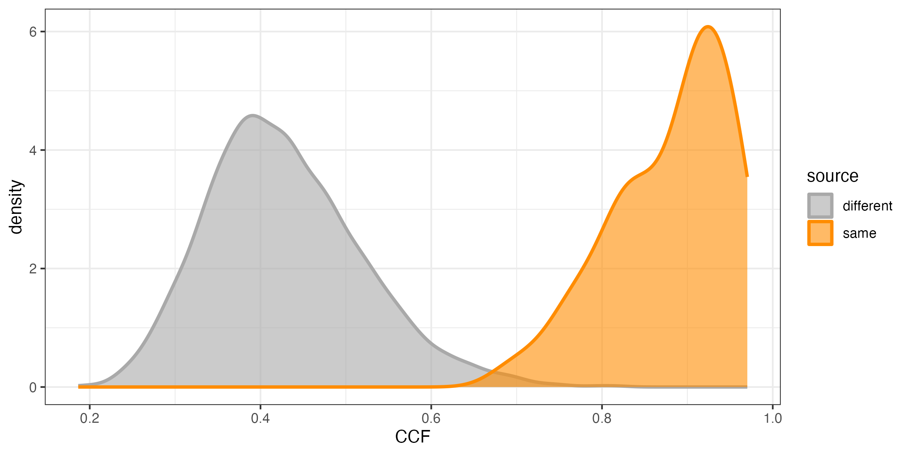
```

To assess variability in scores along the processing pipeline, the second validation examined replicates, stagings, and acquisitions separately.
Tool 2 and the middle location were the randomly selected tool and cutting location for this assessment.
The assessment uses 22 scans from tool 2 at the middle location: eight main-experiment scans and 14 additional scans of replicate 2.
Replicate variability was assessed using two different cuts at the same edge and position.
The comparison in @fig-signals-pair-alignment in Pairwise alignment of signals illustrates this assessment.
Staging comparisons were identified from scan pairs that shared the same replicate and acquisition number but had different staging numbers.
In the available data, these pairs involve replicate 2, which was rescanned under the confocal microscope.
The staging label S identifies these repeated stagings in the naming convention.
The S1 designation is omitted from labels, so R2 is equivalent to R2-S1.
For all four edges of tool 2 at the middle location, three stagings (R2, R2-S2, and R2-S3) were created.
Their pairwise CCFs were summarized by the mean and sample standard deviation (SD) using the comparison categories defined below.


Acquisition comparisons were identified from scan pairs that shared the same replicate and staging but had different acquisition numbers.
In the available data, these pairs all involve staging 3 of replicate 2.
The repeated acquisitions were obtained by keeping the samples on the confocal microscope while varying the lighting conditions.
The suffix A identifies the acquisition within a staging.
For edge A at staging 3, four acquisitions were performed, and the A1 designation was omitted from the first acquisition label.
Therefore, R2-S3 is equivalent to R2-S3-A1.
For the other three edges, two acquisitions were conducted at staging 3.
These acquisitions are denoted by R2-S3 and R2-S3-A2.
Pairwise CCFs for the qualifying acquisition pairs were computed and summarized by their mean and, where more than one pair was available, sample SD.
Variability between distinct stagings was assessed separately through the staging comparisons described above.

Each distinct unordered pair from the same edge was counted once, excluding self-comparisons.
Pairs were selected to compare one factor at a time: different replicates with matching staging and acquisition numbers, different stagings within the same replicate with matching acquisition numbers, or different acquisitions within the same replicate and staging.
Pairs differing in more than one of these settings were excluded.
Applying these pairing rules to the available scans yields replicate comparisons between R1 and R2 at staging 1 and acquisition 1, staging comparisons among S1, S2, and S3 within replicate 2 at acquisition 1, and acquisition comparisons within replicate 2 at staging 3.
These categories contain, respectively, 1, 3, and 6 comparisons for edge A and 1, 3, and 1 for each of edges B, C, and D, giving 25 comparisons in total.


With this setup, CCF values were expected to become more consistent from replicate to staging to acquisition as the scanning conditions became progressively more stable.
Consequently, variability was expected to decrease along this sequence.
Replicates, stagings, and acquisitions were also compared, with smaller differences expected between acquisitions and stagings than between stagings and replicates.
The detailed numerical results, including means, standard deviations, and differences between means, are shown in @tbl-CCF-replicate-staging-acquisition.
Mean CCF increases from replicate to staging to acquisition comparisons for every edge, and, before rounding, the acquisition-to-staging mean differences are smaller than the staging-to-replicate differences.
Replicate SD is undefined for every edge because each has only one pair, so the assessment does not establish whether dispersion decreases across all three comparison categories.
Staging SD is defined for every edge from three pairs.
Acquisition SD is defined only for edge A, where it is lower than staging SD; the other edges each have only one acquisition pair.
Because comparisons share scans, the numerical summaries are descriptive and do not assume independent observations.

::: {#tbl-CCF-replicate-staging-acquisition tbl-cap="Comparison of CCF means and standard deviations across different replicates, stagings, and acquisition settings.
Dashes indicate that the standard deviation is undefined because only one CCF value is available.
Differences between means were calculated before rounding to three decimal places."}

\centering
\begin{tabular*}{\linewidth}{@{\extracolsep{\fill}}lrrrrrrrr@{}}
\toprule
 & \multicolumn{2}{c}{\textbf{Replicate (R)}} 
 & \multicolumn{3}{c}{\textbf{Staging (S)}} 
 & \multicolumn{3}{c}{\textbf{Acquisition (A)}} \\
\cmidrule(lr){2-3} \cmidrule(lr){4-6} \cmidrule(lr){7-9}
\textbf{Edge} 
 & \textbf{Avg$_R$}
 & \textbf{SD$_R$}
 & \textbf{Avg$_S$}
 & \textbf{SD$_S$}
 & \textbf{Avg$_S$ - Avg$_R$} 
 & \textbf{Avg$_A$} 
 & \textbf{SD$_A$}
 & \textbf{Avg$_A$ - Avg$_S$} \\
\midrule
A & 0.836 & --- & 0.965 & 0.013 & 0.128 & 0.992 & 0.003 & 0.027 \\
B & 0.893 & --- & 0.917 & 0.040 & 0.023 & 0.939 & --- & 0.023 \\
C & 0.821 & --- & 0.938 & 0.010 & 0.116 & 0.959 & --- & 0.021 \\
D & 0.792 & --- & 0.963 & 0.023 & 0.171 & 0.986 & --- & 0.023 \\
\bottomrule
\end{tabular*}

:::


The variability assessment does not include variation in CCF values caused by differences in the manual extraction of profiles from scans.
To support reproduction of the results reported here, the extraction locations and values for each scan have been included.


# Usage Notes {#sec-usage-notes .unnumbered}


The raw surface scans are provided in \texttt{x3p} format.
To inspect or process these files in R, use the \texttt{x3ptools} package and its reference manual, available from CRAN [@hofmannX3ptoolsToolsWorking2018].
The supplied profiles and processed signals provide a starting point for users who do not wish to repeat manual profile extraction.
The shared scan identifiers and profile-line images allow these derived files to be related back to the corresponding scans.
To reproduce the main-experiment summaries, select identifiers with \texttt{staging = 1} and \texttt{acquisition = 1} in \texttt{meta.csv}, and retain pairwise rows only when both identifiers are in that set.
For variability assessment, select tool 2 at the middle location, exclude self-comparisons, and count each distinct unordered same-edge pair once.
Use the hierarchical comparison flags together with matching staging and acquisition numbers to select pairs that differ in only one factor, as described in Technical Validation.
Because each supplied signal is based on a manually selected profile, users assessing sensitivity to profile placement should re-extract profiles from the raw \texttt{x3p} scans using alternative documented locations.

Ground-truth source labels, the supplied pairwise CCF values, and the classification and variability assessments provide a descriptive benchmark for developing and evaluating automatic wire-cut matching methods.
The present workflow relies on manually selected profiles followed by computational signal processing, alignment, and scoring.
Automated workflows can be compared against these results using the same scan subsets and comparison definitions.


# Data Availability {#sec-data-availability .unnumbered}

The data and code are deposited with Iowa State University DataShare [@DatasetCodeThreedimensionalDataWirecut] under the reserved DOI \url{https://doi.org/10.25380/iastate.34025028}, which becomes active on dataset publication.
Private peer-review access is available at \url{https://figshare.com/s/2e44a3f30d770a6a513f}.


# Code Availability {#sec-code-availability .unnumbered}


Custom R code was used to inspect raw scans, extract profiles, derive signals, align signals, and generate the validation outputs.
The code is archived in the root-level \texttt{code/} folder of the Iowa State University DataShare deposit [@DatasetCodeThreedimensionalDataWirecut] at \url{https://doi.org/10.25380/iastate.34025028}.
The files and their roles are described in @tbl-code-overview.

```{r}
#| echo: FALSE
#| label: tbl-code-overview
#| tbl-cap: Overview of available code.
#| results: asis

code_files <- c(
  "1-create_pngs_from_x3p.R",
  "2-create_profiles_from_x3p.R",
  "3-create-single-profile-file.R",
  "4-create_signals_from_profiles.R",
  "5-align-pairwise.R",
  "6-all-comparison-results.R",
  "7-variability-assessment.R"
)

string <- tibble(
  group_type = c("Inspect raw scans", rep("Extract profiles", 2), "Derive signals", rep("Compare signals", 2), "Assess variability"),
  code_type = paste0("`", code_files, "`"),
  Description = c("obtain images of `x3p` files in `scans/`", "manually extract profiles from each scan", "combine profile information", "derive signals from each profile", "compute pairwise alignment CCF values", "visualize main-experiment comparisons", "compare replicates, stagings, and acquisitions"),
  Section = c("Scan acquisition", "Signal extraction", "Signal extraction", "Signal extraction", "Pairwise alignment of signals", "Technical Validation", "Technical Validation")
) %>%
  gt(rowname_col = "code_type", groupname_col = "group_type") %>%
  tab_stubhead(label = "Code") %>%
  tab_options(table.width = pct(95), table.font.size = px(14.67)) %>%
  cols_width(Description ~ pct(45), Section ~ pct(30), everything() ~ pct(55)) %>%
  fmt_markdown() %>%
  as_latex()

# column widths code - start
# Keep the three generated columns within the 95% table width.
dimexprs <- str_extract_all(pattern = "dimexpr 0.[0-9]+", string[1])[[1]]
replacement <- paste("dimexpr", c(0.43, 0.31, 0.21))
string[1] <- str_replace_all(
  string[1],
  pattern = "dimexpr 0.[0-9]+",
  replacement = "dimexpr FIX"
)
for (i in seq_along(dimexprs)) {
  string[1] <- str_replace(string[1], "dimexpr FIX", replacement[i])
}

# Allow long monospaced filenames to wrap without changing table font size.
for (code_file in code_files) {
  escaped_file <- str_replace_all(code_file, "_", "\\\\_")
  string[1] <- str_replace(
    string[1],
    fixed(paste0("\\texttt{", escaped_file, "}")),
    fixed(paste0("\\path{", code_file, "}"))
  )
}
# column widths code - end

string
```

The provided code implements the processing, comparison, validation, and visualization workflow described in Methods and Technical Validation.
The supplied \texttt{renv.lock} records R 4.6.1, \texttt{x3ptools} 0.0.4, and the versions of the other R packages in the repository environment.
For GitHub packages, it also records the source repositories and commit hashes.
The archived \texttt{renv/} folder and \texttt{.Rprofile} project startup file support restoration of this environment.

